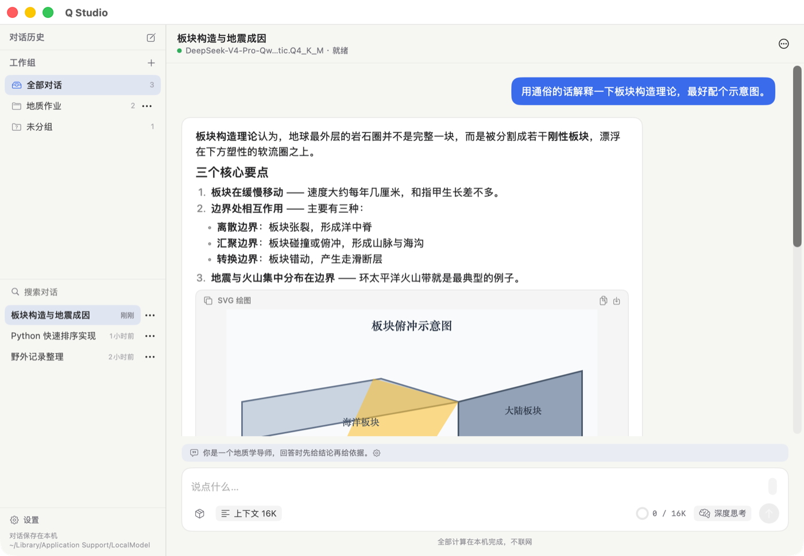
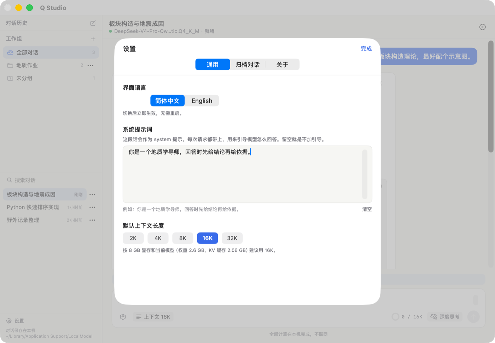
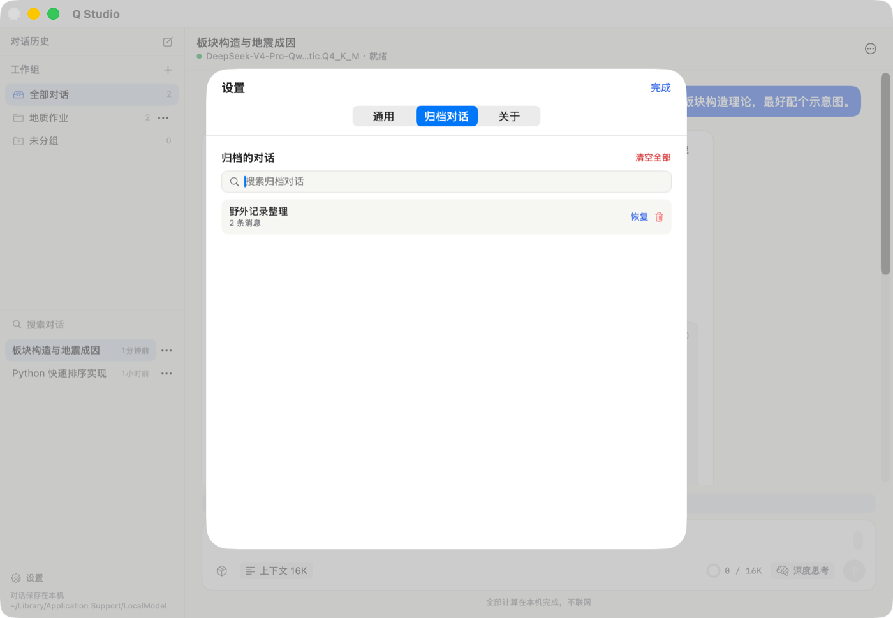

# Q Studio

> **LM Studio 退出的时代空白，由原生轻量的 Intel Mac 本地 AI 客户端补全。**

**语言 / Language:** 简体中文 | [English](#english)

一款 **纯 Swift 原生、macOS Intel(x86) 专属、内置 llama.cpp 推理内核**的离线大模型对话客户端。
不依赖 Ollama、不依赖服务端、不联网、零命令行——把 GGUF 模型拖进来就能对话。

---

## 一、为谁服务 · 核心功能

Q Studio 面向所有**仍在使用 Intel Mac 的用户**，提供完全本地、无后端依赖的 AI 对话能力。

软件内置完整的 llama.cpp 推理内核（Vulkan / MoltenVK 路径），**无需安装 Ollama、无需部署服务、无需依赖任何第三方平台**，打包即独立可用。

功能上只聚焦最刚需的三件事：**离线文本对话、本地 GGUF 模型加载、轻量化推理交互**。去除所有冗余模块，追求极致简洁、低资源占用、高系统适配性。

界面为原生 SwiftUI：左侧工作组与对话历史，右侧对话区，支持 Markdown 渲染、SVG 自动出图、流式输出、深度思考开关、工作组分组、对话归档等。

---

## 二、解决的核心痛点

1. **主流工具已经不再覆盖 Intel Mac。** LM Studio 官方系统要求明确标注「Intel-based Macs are currently not supported」；Jan 自 0.8.5 起也不再在 Intel Mac 上运行本地模型。Intel 用户失去了最主流的一体化本地 AI 工具。
   （来源：[LM Studio 官方文档 · System Requirements](https://lmstudio.ai/llms.txt)）

2. **原生 macOS AI 客户端几乎都只为 Apple Silicon 开发。** 依赖 Metal 加速，不兼容老 Intel 架构；Apple 也已确认 macOS Tahoe 26 是最后一个支持 Intel 的系统版本，后续软件支持只会越来越薄。

3. **现存能在 Intel Mac 跑的工具普遍有硬伤：**
   - Electron 套壳客户端——体积臃肿、内存占用高、卡顿
   - Ollama 前端壳子——**不带推理引擎**，必须手动部署后台，新手门槛高，无法开箱即用
   - 纯 llama.cpp 命令行——能用，但没有图形界面

4. **结果是 Intel Mac 长期处于「没有轻量、原生、独立可运行的本地 AI 软件」的空白状态。**

本项目精准填补这一空白：**Intel Mac 平台上「原生、独立、内置推理、开箱即用」的离线 AI 客户端。**

---

## 三、为什么要用 Q Studio

1. **极少数仍在维护的 Intel Mac 独立本地 LLM App**
   不依赖 Ollama、不依赖网页、不依赖终端命令。在主流工具陆续撤离 Intel 平台后，它是少数还能开箱即用的选择。

2. **纯 Swift 原生开发**
   对比 Electron 跨端工具：启动更快、内存更低、系统权限更干净，Mac 体验最正统。

3. **极致轻量化定位**
   舍弃 RAG、Agent、插件、模型市场等臃肿功能，只做离线对话这一件事，低配老 Mac 也能稳定运行。

4. **真正开箱即用**
   内置推理内核，用户只需导入一个 GGUF 模型即可对话——零命令行、零部署、零配置。

5. **完全本地隐私**
   所有推理和对话记录都在本机，不上传、不联网。隐私性远超网页端和云端 AI 工具。

---

## 四、模型文件放在哪

### 1. 应用扫描的目录（放这里就能被识别）

App 启动时会自动扫描以下三个目录**顶层的 `.gguf` 文件**（不递归子目录），按文件名排序：

| 目录 | 路径 | 用途 |
|---|---|---|
| 家目录 `models` | `~/models/` | 推荐，自己下载/软链模型放这里 |
| 下载目录 | `~/Downloads/` | 浏览器下载完直接能用 |
| 应用支持目录 | `~/Library/Application Support/LocalModel/models/` | 推荐长期存放 |

找到的第一个模型会自动设为当前模型，也可以在界面里切换。

> 只要把 `.gguf` 文件放进上面任一目录，重启 App（或在模型管理里重新扫描）即可。
> 不需要改任何配置。

### 2. 从哪里获取模型

Q Studio **不在应用内下载模型**。打开「模型管理 → 获取模型」可以看到一批经过显存适配标注的推荐模型（Qwen、Llama、Gemma、Phi 等），每个都带一个网页链接——点击后在浏览器中打开模型页，自行下载 `.gguf` 文件，再放进上面任一目录。

需要其它模型可点「浏览全部 GGUF 模型」去 Hugging Face / hf-mirror 搜索。**App 本身不联网、不下载任何东西。**

### 3. 对话数据放在哪

```
~/Library/Application Support/LocalModel/sessions.json   # 对话记录
~/Library/Application Support/LocalModel/groups.json     # 工作组分组
```

---

## 五、怎么加载模型

### 方式 A：自己准备 GGUF 文件（最通用）

1. 从 Hugging Face 下载任意 GGUF 量化模型（Qwen、Llama、Gemma、Mistral、Phi 等）。
2. 把 `.gguf` 文件放到 `~/models/` 或 `~/Downloads/`。
3. 打开 App，启动时自动扫描并选中第一个模型。

### 方式 B：通过推荐链接下载

1. 打开 **模型管理**（工具条左侧的立方体图标），切到「获取模型」。
2. 列表里已标注每个模型的体积和显存适配情况（推荐 / 偏紧 / 超出显存）。
3. 点「打开网页」在浏览器打开模型页，下载合适量化的 `.gguf`。
4. 把文件放进 `~/models/`，回到「本机模型」点「使用」。

### 方式 C：切换已有模型

模型管理界面的「本机模型」标签列出所有扫描到的 `.gguf`，点「使用」即可切换。切换会重启推理服务。

模型加载在后台完成，加载大模型需要几十秒，期间显示「Loading model」，属正常。
上下文长度默认 8192，可在工具条按显存和模型调整（2K–32K 可选）。

### 显存不够怎么办

- 换更小的量化（Q4_K_M 比 Q8_0 省一半）
- 调小上下文长度（工具条的「上下文」按钮）
- 保持 KV 缓存量化开启（设置 →「KV 缓存精度」→ q8_0）：KV 缓存随上下文线性增长，
  压到 8 位大约省一半，同样显存能开两倍上下文。启动时若模型不支持会自动回退 fp16
- 显存估算 = 权重 + KV 缓存 + 运行时开销，仅供参考；实际占用随上下文浮动

---

## 六、使用者配置要求（重要）

启动时会探测硬件。**只要系统能报告 Metal 加速器，就放行进入主界面**；
对性能不理想的组合会在窗口顶部显示一条黄色「硬件性能提示」横幅（可关闭），把预期讲清楚，
而不是一刀切拒绝。只有 Apple Silicon 和完全检测不到 GPU 这两种情况会被拒绝。

### 支持的组合

| CPU | 显卡 | 是否支持 | 说明 |
|---|---|---|---|
| **Intel** | **AMD 独立显卡（≥ 2 GB 显存）** | ✅ **推荐** | 最佳组合，走 Vulkan / MoltenVK，实测性能最好 |
| Intel | NVIDIA 独显（黑苹果，需 1401 驱动） | ⚠️ 支持，有提示 | 见下方说明 |
| Intel | Intel 核显 | ⚠️ 支持，有提示 | 可跑但明显偏慢，建议 1.5B 以下小模型 + 2K–4K 上下文 |
| Apple Silicon（M 系列） | Apple GPU | ❌ 不支持 | 原生 Metal 更快，经 MoltenVK 转发反而慢 |

**关于 NVIDIA 显卡（黑苹果）**：自 2026 年 10 月起，开源项目
[NullMoth 1401 / nvidia-macos-driver](https://github.com/nullmoth/nvidia-macos-driver)
为 Turing 及之后的 N 卡（GTX 16、RTX 20/30/40/50）提供了 macOS 15.5+ / 26 上的 Metal 3 驱动。
只要装好驱动、`system_profiler SPDisplaysDataType` 显示 `Metal: supported`，MoltenVK 就能识别到这张卡，
本软件即可运行。App 检测到 NVIDIA 卡时会提示你确认驱动状态。
**没有 Metal 驱动时 N 卡不会被识别，推理会退回 CPU 或失败**——这属于系统驱动层面，本软件无法绕过。

> 性能预期：核显或走翻译层的组合虽然能进界面，但推理速度会显著低于 AMD 独显路径。
> 建议从最小模型试起，再决定是否升级硬件。

### 系统与应用要求

- **macOS 14.0+**，x86_64 架构（Intel Mac）；NVIDIA 卡装 1401 驱动时需 macOS 15.5+
- 有 Metal 加速器；显存 ≥ 2 GB 体验较好（低于此值只给警告，可用小模型试）
- 应用包内已内置 llama-server 与 MoltenVK，**不需要额外安装 Vulkan SDK**
- 内置推理引擎面向 x86_64 编译，Apple Silicon 不适配

### 为什么推荐 AMD 独显

本项目走 Vulkan / MoltenVK 推理路径。在这代 Intel 平台的 GPU 上，Vulkan 通常比 Metal 快得多：
老架构显卡的 Metal 支持只到 Common3，缺少矩阵指令，会退化成标量路径。
其它 Intel 平台（核显、装了 1401 的 N 卡）理论上也能用，但受算力、内存带宽或翻译层开销限制，
性能会明显更低——所以软件给提示而不拦截。

---

## 七、功能一览

- **工作组**：左栏上半是工作组（对话分组），下半是对话。选中组后新开的对话自动归组；也可右键对话加入/移出组。删除组不删对话，只把它们变成未分组。
- **对话**：流式输出、Markdown、代码高亮、SVG 自动渲染（裸 `<svg>` 也能识别）、思考过程折叠显示、消息级性能指标（token 数 / TPS / 耗时）。
- **深度思考**：输入框右下角开关，控制模型是否输出思维链（会重载模型）。
- **KV 缓存量化**：默认开 q8_0，长上下文下省一半 KV 显存；启动失败自动回退 fp16，显存估算同步按实际精度计算。
- **菜单栏**：常驻菜单栏图标，点开可切最近 5 个对话；关窗口不退出，推理服务继续保留。
- **归档**：对话右键归档，归档内容在「设置 → 归档的对话」里管理和恢复。
- **标题**：首轮对话后由模型自动生成短标题，失败时回退为第一条消息截断。

## 界面预览

**对话界面** —— 流式输出、Markdown 渲染、SVG 示意图、消息级性能指标：



**设置 · 通用** —— 界面语言、系统提示词、上下文长度：



**设置 · 归档对话** —— 归档管理与搜索：



---

<a id="english"></a>

# Q Studio

> **The void left by LM Studio's exit, filled by a native, lightweight local AI client for Intel Macs.**

A **pure Swift, macOS Intel (x86)-only offline LLM chat client** with a built-in llama.cpp inference engine.
No Ollama, no server, no cloud — drop in a GGUF model and start chatting.

---

## 1. Who it's for · What it does

Q Studio is built for everyone **still using an Intel Mac**, offering fully local AI chat with no backend dependency.

It ships a complete llama.cpp inference engine (Vulkan / MoltenVK), so **there is no Ollama to install, no service to deploy, and no third-party platform involved** — the app is standalone out of the box.

It focuses on three essentials only: **offline text chat, local GGUF model loading, and lightweight inference interaction**. Everything redundant is stripped out in pursuit of simplicity, low resource usage, and tight system integration.

The native SwiftUI interface has workspaces and chat history on the left, conversation on the right, with Markdown rendering, automatic SVG output, streaming responses, a Deep Thinking toggle, chat grouping, and archiving.

---

## 2. The gap it fills

1. **Mainstream tools have left Intel Macs behind.** LM Studio's official system requirements explicitly state "Intel-based Macs are currently not supported"; Jan no longer runs local models on Intel Macs since 0.8.5. Intel users lost their most popular all-in-one local AI tool.
   (Source: [LM Studio System Requirements](https://lmstudio.ai/llms.txt))

2. **Almost every native macOS AI client targets Apple Silicon only.** They rely on Metal acceleration and don't support older Intel hardware; Apple has also confirmed macOS Tahoe 26 is the last release for Intel Macs, so support will keep thinning.

3. **The tools that still run on Intel Macs all have serious flaws:**
   - Electron wrappers — bloated, memory-hungry, sluggish
   - Ollama front-ends — **no inference engine bundled**; you must deploy a backend manually, with a steep learning curve
   - Plain llama.cpp CLI — works, but has no graphical interface

4. **The result: Intel Macs have long lacked a lightweight, native, standalone local AI client.**

Q Studio fills exactly that gap: **a native, standalone, inference-bundled, ready-to-use offline AI client for Intel Macs.**

---

## 3. Why Q Studio

1. **One of the very few actively maintained standalone local LLM apps for Intel Macs**
   No Ollama, no browser, no terminal. As mainstream tools retreat from Intel, it's one of the last truly ready-to-use options.

2. **Pure Swift, native**
   Compared to Electron cross-platform tools: faster launch, lower memory, cleaner permissions, and a more authentic Mac experience.

3. **Radically lightweight**
   No RAG, agents, plugins, or model marketplace — chat is the one thing it does well, so even older low-spec Macs run it smoothly.

4. **Truly ready to use**
   Inference engine included. Import a GGUF model and chat — zero commands, zero deployment, zero configuration.

5. **Fully local privacy**
   All inference and chat history stay on your machine. Nothing is uploaded — far more private than web or cloud AI tools.

---

## 4. Where model files go

### 4.1 Directories scanned at launch

The app scans the **top level** of these three directories for `.gguf` files (not recursive), sorted by filename:

| Directory | Path | Purpose |
|---|---|---|
| Home `models` | `~/models/` | Recommended — place your own downloads or symlinks here |
| Downloads | `~/Downloads/` | Browser downloads just work |
| App Support | `~/Library/Application Support/LocalModel/models/` | Recommended for long-term storage |

The first model found becomes the active model; you can also switch in the UI.

> Just put a `.gguf` file in any of the above directories and restart the app (or rescan in Model Manager).
> No configuration needed.

### 4.2 Where to get models

Q Studio **does not download models inside the app**. Open **Model Manager → Get Models** to see a curated list annotated with VRAM fit (Qwen, Llama, Gemma, Phi, etc.), each with a web link — click to open the model page in your browser, download the `.gguf`, then place it in one of the directories above.

For anything else, use "Browse all GGUF models" to search Hugging Face / hf-mirror. **The app itself never goes online or downloads anything.**

### 4.3 Chat data location

```
~/Library/Application Support/LocalModel/sessions.json   # conversations
~/Library/Application Support/LocalModel/groups.json     # workspaces
```

---

## 5. How to load a model

### A. Bring your own GGUF (most general)

1. Download any quantized GGUF model from Hugging Face (Qwen, Llama, Gemma, Mistral, Phi, etc.).
2. Put the `.gguf` file in `~/models/` or `~/Downloads/`.
3. Open the app — it scans and selects the first model at launch.

### B. Follow a recommended link

1. Open **Models** (the cube icon in the toolbar), switch to **Get Models**.
2. The list shows each model's size and VRAM fit (Recommended / Tight / Out of VRAM).
3. Click **Open page** to open the model page in your browser and download a suitable quantized `.gguf`.
4. Put the file in `~/models/`, then click **Use** under the Local models tab.

### C. Switch an existing model

The **Local models** tab lists all discovered `.gguf` files; click **Use** to switch. Switching restarts the inference service.

Model loading happens in the background and takes tens of seconds for large models — "Loading model…" is normal.
Context length defaults to 8192 and is adjustable in the toolbar (2K–32K).

### Not enough VRAM

- Use a smaller quantization (Q4_K_M is about half the size of Q8_0)
- Reduce context length (the toolbar's context button)
- Keep KV cache quantization on (Settings → "KV cache precision" → q8_0): the cache grows
  linearly with context, and 8-bit halves it, so the same VRAM fits twice the context.
  If the model cannot start with it, the app falls back to fp16 automatically
- VRAM estimates = weights + KV cache + runtime overhead, for reference only; actual usage varies with context

---

## 6. System requirements

At launch the app probes hardware. **Any system that reports a Metal accelerator is allowed in**;
combinations with poor performance show a dismissible yellow "hardware performance note" banner at the top
rather than being blocked. Only Apple Silicon and systems with no GPU detected are refused.

### Supported combinations

| CPU | GPU | Support | Notes |
|---|---|---|---|
| **Intel** | **AMD discrete (≥ 2 GB VRAM)** | ✅ **Recommended** | Best combination; Vulkan / MoltenVK |
| Intel | NVIDIA discrete (Hackintosh, needs 1401 driver) | ⚠️ Supported, with note | See below |
| Intel | Intel integrated | ⚠️ Supported, with note | Runs but noticeably slower; use sub-1.5B models + 2K–4K context |
| Apple Silicon (M series) | Apple GPU | ❌ Not supported | Native Metal is faster; MoltenVK forwarding is slower |

**On NVIDIA GPUs (Hackintosh)**: since October 2026, the open-source
[NullMoth 1401 / nvidia-macos-driver](https://github.com/nullmoth/nvidia-macos-driver)
provides Metal 3 drivers on macOS 15.5+ / 26 for Turing-and-newer cards (GTX 16, RTX 20/30/40/50).
With the driver installed and `system_profiler SPDisplaysDataType` showing `Metal: supported`, MoltenVK can see the card and the app runs.
**Without a Metal driver the card isn't recognized and inference falls back to CPU or fails** — that's at the system driver level and can't be worked around here.

> Performance expectation: integrated GPUs and translation-layer setups do run, but are significantly slower than the AMD discrete path. Start with the smallest model before deciding on a hardware upgrade.

### System & app requirements

- **macOS 14.0+**, x86_64 (Intel Mac); NVIDIA cards with the 1401 driver need macOS 15.5+
- A Metal accelerator present; ≥ 2 GB VRAM is recommended (lower only warns; small models may still run)
- llama-server and MoltenVK are bundled — **no separate Vulkan SDK needed**
- The inference engine is built for x86_64; Apple Silicon is not supported

### Why AMD discrete is recommended

The project uses the Vulkan / MoltenVK inference path. On this generation of Intel-platform GPUs, Vulkan is typically much faster than Metal:
older GPU architectures only support Metal up to Common3 and lack matrix instructions, falling back to scalar paths.
Other Intel platforms (integrated GPUs, NVIDIA cards with 1401) work in theory but are limited by compute, memory bandwidth, or translation overhead — hence the warning rather than a block.

---

## 7. Features

- **Workspaces**: left pane is split — groups on top, chats below. New chats are automatically added to the selected group; right-click a chat to add/remove it. Deleting a group doesn't delete its chats, it just ungroups them.
- **Chat**: streaming output, Markdown, syntax highlighting, automatic SVG rendering (bare `<svg>` supported), collapsible reasoning, per-message performance metrics (token counts / TPS / latency).
- **Deep Thinking**: toggle at the bottom right of the input box controls whether the model emits chain-of-thought (reloads the model).
- **KV cache quantization**: q8_0 by default — halves KV memory at long context. Falls back to fp16 automatically if the model cannot start, and VRAM estimates follow the precision actually in use.
- **Menu bar**: a status bar icon lists the 5 most recent chats; closing the window no longer quits, so the inference service keeps running.
- **Archive**: right-click a chat to archive; manage and restore under Settings → Archived chats.
- **Titles**: a short title is generated after the first exchange, falling back to a truncated first message on failure.

## Screenshots

**Chat** — streaming output, Markdown, SVG rendering, per-message performance metrics:


**Settings · General** — interface language, system prompt, context length:


**Settings · Archives** — archived chats with search:


